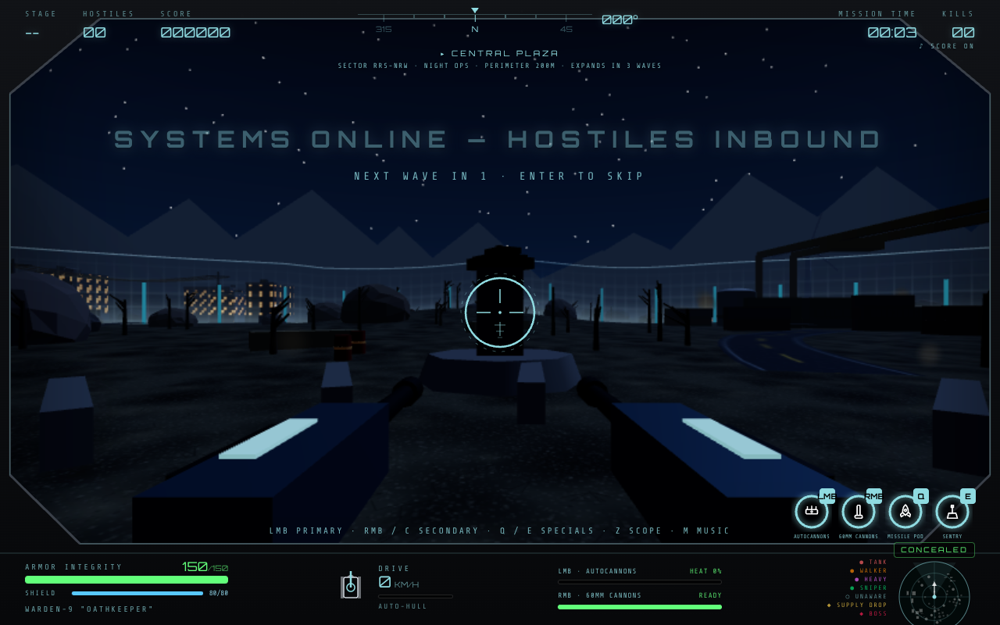

# STEEL HORIZON — The Iron Colosseum

A first-person tank and mech combat simulator that runs entirely in the browser.
Take the gunner's seat of a salvage rig, drop into a procedurally generated
sector, and survive escalating waves of hostile armour. Credits earned in the
sand are spent in **THE FORGE**, where you buy components, strip mounts, save
named builds and watch the mech assemble on a live 3D factory floor.

Built with **React 19 + TypeScript + Vite + three.js**. Everything you see is
generated at runtime: the terrain, the districts, the roads, the sky, the
mechanics, and every single sound.


---

## Quick start

```bash
cd smech
npm install
npm run dev        # http://localhost:5173
```

Production build (a single self-contained `dist/index.html`):

```bash
npm run build
npm run preview
```

Quality gates:

```bash
npm run typecheck  # tsc --noEmit
npm run lint       # eslint
npm run test       # vitest
npm run check      # all three
```

### Playing the published build

The production build inlines every asset — JavaScript, CSS and three.js — into
one HTML file, so it can be served from any static host. `preview/index.html` in
this repository is that file, regenerated with:

```bash
npm run build
npm run preview:prepare   # copies dist/index.html -> ../preview/index.html
```

It is committed on purpose so the game can be opened straight from a raw file
URL, with no server and no install step:

```
https://raw.githubusercontent.com/shenbigdisk-cmd/sgame/main/preview/index.html
```

---

## Controls

| Input | Action |
| --- | --- |
| `Mouse` | Aim the turret / camera |
| `LMB` / `Space` | Primary weapon (autocannons, scattergun, coil repeater) |
| `RMB` / `C` | Secondary weapon (cannons, flamethrower, cryo lance, cryo grenade, EMP gun) |
| `Q` / `E` | Chassis special hardpoints |
| `W A S D` | Drive (relative to your view in **EASY**, hull-relative in **SIM**) |
| `Z` / `MMB` | Scope |
| `M` | Music on / off |
| `Esc` | Release the mouse (pause menu) |
| `1` `2` `3` | Pick an upgrade after a wave |
| `Enter` / `N` | Call the next wave early |



On touch devices, drag on the left to move and drag on the right to aim. Tap or
hold the right side to fire primary; once firing, drag to aim while holding. To
fire secondary, add a second finger on the right (start both touches together,
or drag first, to fire it without the primary). Tap the round Q/E controls to
use additional weapons and the small top-right scope button to zoom. Empty
sockets do not fire.

---

## The three chassis

| Chassis | Role | Factory loadout | Reactor |
| --- | --- | --- | --- |
| **WARDEN-9 "Oathkeeper"** | Balanced veteran | Rotary autocannons · 60mm cannons · Homing missiles · Sentry turret | Standard Core |
| **PYRE-12 "Crowd-Eater"** | Fire brawler | Scrap scattergun · Dragon's Breath · Skyfall orbital · Cinder mines | Fused Capacitor |
| **GLACIER-7 "The Exile"** | Cryo duelist | Coil repeater · Cryo grenade · Longbow railgun · Veil smoke | Titan Reactor |

Each factory blueprint is power-positive: its reactor output covers the
sustained draw of the mounted loadout. Swapping in heavier toys can still run
the grid into deficit, which the Forge flags before you deploy.

---

## Systems

### Procedural sectors
Every seed (`ABC-123`) deterministically builds a theme (time of day, weather,
palette), a district layout with named regions, a road network, water bodies,
hills and cover. The perimeter expands every third wave, revealing new
districts and two supply pods in the newly opened ring. Clearing a stage
generates a fresh sector from a deterministic per-stage seed; the old arena's
meshes are disposed, the theme and sky are rebuilt, and the mech is moved to
the new pit with a repair kit nearby.

The deployment preview shows the sector condition before you launch: **Grid
surge** boosts reactor recharge by 25%, **Cold front** improves weapon cooling
by 30%, and **Signal haze** reduces enemy sight range by 20%. The landing
plaza varies its high cover and low firing positions with the seed. Look for
ring markers on radar: hold inside a green field relay for two uninterrupted
seconds to repair, or an amber relay to gain 25 seconds of rapid reload. Each
can be claimed once in that sector.

### Waves
Waves mix eight enemy chassis and can roll `SWARM`, `ARMORED PUSH`, `SNIPER NEST`,
`FLANKING AMBUSH` or `REPAIR CONVOY`. Convoys form up around a **Mender**,
which repairs a wounded ally within 42 m every four seconds if it has line of
sight. Eliminate it first or separate it from the formation. The **Bastion**
halves bullet damage but takes 1.5× damage from shell and rocket impacts.
Raiders, Hounds, Goliaths and Longbows round out the roster. Watch for the
**Ember Sapper**: a demo rig that sprints at your hull and ram-detonates —
destroying it still cooks the core off at half force, and its blast wounds
anything nearby, friend or foe. Inspect **Enemy intel** in the hangar for all
eight counters. Every fifth wave a
**WARLORD** boss enters the arena. Between waves the arena is repaired, the
shield is refilled and you choose one of three rewards.

Clearing a stage earns a beat of celebration before the reward draft appears:
the arena stays live for 2.8 seconds of stage time so the clear, the crowd and
the wreck can land, and a `REWARD DRAFT IN N` countdown tells you the draft is
on its way. The next sector is built once that celebration finishes.

### Salvage Rush and sky loot
Deploy normally: special encounters are rolled automatically, not selected in the hangar.
Salvage Rush can occur on any non-boss wave, including the opener. When it does,
two gold credit caches and one random combat core descend into the arena. The Jackal
runner races to a landed cache and retreats with it; destroy a loaded runner to
recover its cargo. Follow the gold bearing and distance on the HUD, then drive
over a landed cache to **bank 25–60 Forge credits immediately**. Unclaimed
caches stay behind when you leave the sector. A cleared Salvage Rush allows a
10-second sweep; press Enter or tap Extract to leave early.

The Field manual lists all nine supply symbols, which match the radar and world-space crate labels.
Regular air shipments can also carry coins, **Aegis** (six seconds of immunity
for hull and shield), or **Overcharge** (+35% offensive damage for 25 seconds).
Repeat cores refresh the timer instead of stacking. Veil smoke is not Aegis:
hostile bullets dissipate in it, but shells and rockets retain 70% damage.
Rockets lose guidance, sniper locks break, and recently alerted enemies can
continue suppressing their last known contact. The base cloud lasts six seconds;
even a fully upgraded belt leaves a gap between screens. Relocate rather than
sitting in the cloud.

Q carries **five charges** and E carries **three**. Every stage begins with both mounted racks fully refilled and their cooldowns reset. One activation uses one charge, even for a whole salvo or mine pattern. A blue **Rearm crate** restores one to each equipped rack up to its slot’s capacity; it does not skip cooldowns. If a rack is empty and no rearm crate is on the field, the next ordinary shipment carries one. Primary and secondary weapons do not use cartridges.

Pyre’s **Skyfall Orbital** marks the ground or visible enemy under the sight, then brings a broad barrage straight down from above. Its first blast damages the full 24-metre radius; six more impacts follow. Targeting Uplink widens the area and shortens its cooldown, while Zenith Protocol further widens and strengthens the strikes. The Cinder Canister remains available for custom builds, where its impact leaves six seconds of ground fire.

### Cover and reactor tactics
Amber bands mark breachable buildings, warehouses, towers, ruins and blast screens. The sight stays a pale, broken ring over cover and open ground. It turns solid red when a visible enemy overlaps the ring; aiming never opens a target label. Shells and rockets can bring these structures down. Facade sections tumble into dust and leave traversable rubble. Keep a relay screen for protection while capturing, or blast a shorter approach. Low-flying Wisp scouts can cross low cover but take 50% extra bullet damage.

Your reactor starts full. The hangar lists each weapon's kJ cost, and the round special controls show charges, cooldown, low power, or rearm status. Shield recovery is automatic. **Induction Loop** refunds 8 kJ per kill per rank; **Breach Charges** adds 50% base structure damage per rank.

### Combat readouts
Damage you deal is projected onto the cockpit as it lands: hull damage floats
off the target, critical hits read larger and amber, and banked score pops up
in gold (with the chain multiplier when you are streaking). Rapid hits on the
same unit merge into a single climbing readout instead of a spray of
numbers.

### Rewards
Repeat picks show their new rank in the name: **Flux Regulator**, then **Flux Regulator 2**. One-time upgrades and instant repairs stay unnumbered. On the cockpit, a weapon's **+N** badge counts installed ranks that affect it, including shared weapon bonuses and evolutions. An evolved weapon has a violet badge. The Q/E badges stay visible while reloading or empty; upgraded primary and secondary guns get small icon badges above the hull meter. Hull-only perks and instant repairs do not increase a weapon's count.

Upgrades roll as **STANDARD / RARE / EPIC** and cover hull, weapon, system and
signature categories. Weapons can be **evolved** into stronger forms
(`STATIC LINK`, `CONCUSSION CORE`, `ABSOLUTE ZERO`, …), and signature upgrades
introduce new mechanics (cluster munitions, reactive armour, overcharged
rounds, repair swarm, killstreak surge, arc discharger, bulwark field,
saturation barrage, supply network, last circuit). **Last circuit** floods
your weapons for +35% damage while the hull is below 35% — a dying machine
fights harder.

Every weapon has exactly one evolution, and an evolution only appears once you
own the weapon it upgrades. Forge specials evolve too:

| Forge special | Evolution | Effect |
| --- | --- | --- |
| `SKYFALL ORBITAL` | `ZENITH PROTOCOL` | Strikes cover a wider area and deal more damage |
| `INCENDIARY MORTARS` | `THERMAL DRUMS` | Pools burn hotter and longer, and never scorch you |
| `STASIS NOVA` | `GLACIAL SHATTER` | Nova deals 20 damage and leaves enemies brittle |
| `OVERDRIVE VENT` | `REACTOR PURGE` | Venting restores shield and purges weapon heat |
| `CRYO LANCE` | `GLACIAL LOCK` | Chilled targets build frost and freeze solid |

### THE FORGE
There is no loot to scavenge. **Credits** are the currency, and they are earned
by fighting: every run pays out on score, waves cleared, kills and personal
bests. A new pilot starts with 600 CR. Open **THE FORGE** from the hangar and
spend them.

Eight slots make up a mech, and every one of them is yours to fill — or leave
empty:

| Slot | What it takes | Example |
| --- | --- | --- |
| `FRAME` | The required chassis; its cost is included when building a custom mech | `WARDEN`, `PYRE`, `GLACIER` |
| `PRIMARY` | The trigger weapon | Rotary autocannons, scattergun, coil repeater |
| `SECONDARY` | The heavy weapon | 60mm cannons, cryo grenade, Dragon's Breath, cryo lance, Volt EMP |
| `SPECIAL · Q` | One of the Forge specials | Homing missiles, Skyfall orbital, longbow railgun |
| `SPECIAL · E` | A second special | Sentry turret, cinder mines, veil smoke |
| `ARMOUR` | Hull plating | Lattice armour, ablative carapace, reactive skin |
| `REACTOR` | Shield and power | Standard core, fused capacitor, titan reactor |
| `DRIVE` | Legs and speed | Sprint servos, skimmer legs, anvil drive |


The factory floor is a live three.js scene: drag to rotate the mech, scroll to
zoom, and watch the frame, weapons, armour, reactor and legs change as you fit
them. Every catalogue component has its own model key, including the upgraded
barrels, sawn-off scattergun, vented flame, deep-freeze lance, swarm pod and
the six bespoke hull systems.

Two build systems make the catalogue more than a list of parts:

* **MASS** — every component has a dry weight in tonnes. A stock loadout sits
  at a factor of 1; strip the guns off and the mech sprints, bolt on a siege
  cannon and it waddles. The Forge shows total mass and the resulting speed and
  turn rate.
* **POWER** — the reactor stores energy (`KJ`) and trickles it back into the
  grid (`KJ/S`). Hull systems draw 4 KJ/S; each mounted weapon advertises its
  activation cost and sustained draw. Activation costs are tracked by cockpit
  socket (`PRIMARY`, `SECONDARY`, `SPECIAL · Q`, `SPECIAL · E`), so two specials
  never overwrite each other and a stripped socket costs nothing. A deficit
  means the reactor cannot sustain continuous fire; the buffer still absorbs
  bursts until it runs dry.

Trigger weapons list their **base maximum range** in metres: projectiles expire
after that much travel, and beams stop at their reach. Some in-run upgrades can
extend that range. Cover, terrain and ballistic drop can stop a shot sooner;
the cryo grenade is lobbed rather than fired straight. Aim assist cannot acquire
a target beyond the mounted gun's reach. In the Forge, longer-range or more stable variants cost more, and trade
weight, power, heat or cycle speed for their advantages rather than greatly
increasing base damage.

**Stability** is the percentage of additional moving-shot spread absorbed by a
projectile weapon. It applies while strafing as well as driving forward. Atlas
and Anvil drives add 22 and 30 percentage points respectively, capped with the
weapon at 95%; they do not improve a stationary shot or beams. The **Volt EMP
Disruptor** sacrifices damage and energy for a 1.5-second disable on a direct
hit (0.45 seconds on bosses). A target resists further EMP stuns for four
seconds, preventing a permanent lock. Circuit Breaker evolves it to arc to one
nearby target with a shorter disable. All mechs already have sniper-lock HUD
and audio warnings; these are not a paid upgrade.

Primary, secondary and special weapon tuning are isolated by socket. A primary
scattergun has its own damage, reload, muzzle speed and splash fields and cannot
overwrite the secondary cannons; beams and cryo grenades use their own damage
and cycle fields. The three factory presets all ship with balanced grids, while
greedy custom builds still produce a visible power warning.

The yard also keeps up to **eight named custom builds**. Save the current
assembly, rename it, load it back or delete it from the rack. Empty mounts are
part of the build and survive a reload.

### Persistence
Credits, every component you own, the mech name, the exact mounted build and
the named build rack are written to `localStorage` under
`steel-horizon:garage:v2`. Saves from `steel-horizon:garage:v1` are migrated
automatically, including their owned parts, so old pilots keep their purchases.
Invalid or tampered component ids are sanitised; deliberately empty sockets are
not. Cockpit settings (sensitivity, field of view, invert look, render quality,
volumes, crosshair, performance readout) and the hall-of-fame records are stored
alongside them.

### Feedback
The cockpit lists every active timed effect and its remaining seconds, including
Aegis, rapid reload, damage boosts, surge and overdrive, on both desktop and
touch screens. **VEILED IN SMOKE** and a soft edge shimmer appear only while
the pilot is actually inside a live cloud. Its countdown is the cloud's
remaining life, not a guarantee if you leave it. The separate **VEIL SPRINT**
can continue after leaving. **Undetected** merely means no enemies are aware of
you; it does not mean you are inside smoke or immune to damage.

Procedural audio (weapons, explosions, engines, ambience and an adaptive
score) is synthesised with the Web Audio API and spatialised with stereo pan,
distance muffling and speed-of-sound delay. Ballistic, scatter, coil, flame and
cryo weapons each have distinct layered sounds; dense impacts are coalesced to
keep the mix clear. Master and music volumes remain separately adjustable. A
slim cockpit rim and floating HUD instruments keep the combat view open without
a solid bottom banner. Hull and shield bars sit at the bottom left, two round
special-weapon indicators at the bottom center, and a larger tactical radar at
the bottom right. The circular sight turns red over a visible enemy without
covering it with text. One notice at a time shows threats, objectives or routine
updates, while status timers retain their own space away from the sight.

Cockpit design references: [Hawken Reborn's HUD update](https://hawkenreborn.com/devblog/update02/) discusses high-contrast health bars and cockpit-integrated UI, while [Titanfall 2's Titan HUD](https://interfaceingame.com/screenshots/titanfall-2-titan-hud-in-combat/) shows how instruments can frame rather than fill the combat view. These informed the layout; no game assets were reused.

---

## Project layout

```
smech/
├─ index.html
├─ vite.config.ts          # single-file production build
├─ vitest.config.ts
├─ eslint.config.js
└─ src/
   ├─ App.tsx               # screen flow: hangar → arena → debrief
   ├─ components/
   │  ├─ Menu.tsx           # hangar: chassis, loadout, legend, config, hall of fame
   │  ├─ Forge.tsx          # THE FORGE: presets, saved builds, gauges, purchases, mounts
   │  ├─ FactoryView.tsx    # live 3D factory floor
   │  ├─ GameView.tsx       # canvas host, pause menu, loading screen
   │  ├─ HUD.tsx            # cockpit instruments, radar, crosshair, modules
   │  ├─ UpgradeScreen.tsx  # between-wave reward draft
   │  ├─ GameOver.tsx       # debrief and hall of fame
   │  ├─ SettingsPanel.tsx  # cockpit configuration
   │  ├─ TouchControls.tsx  # movement stick and aiming/firing gestures
   │  ├─ Icons.tsx          # inline SVG icon set
   │  └─ FullscreenButton.tsx
   └─ game/
      ├─ engine.ts          # simulation: player, enemies, weapons, effects
      ├─ world.ts           # façade over the world generator
      ├─ layout.ts          # seeded sector layout: theme, districts, terrain
      ├─ mapBuilder.ts      # dresses a layout into a lit, animated arena
      ├─ colliders.ts       # static obstacle grid and collision helpers
      ├─ rng.ts             # seeded utilities and per-stage sector codes
      ├─ enemyMeshes.ts     # procedural tank / walker / heavy meshes
      ├─ mechModels.ts      # procedural factory models for every component
      ├─ particles.ts       # instanced billboard particle system
      ├─ readiness.ts       # pure weapon-readiness and aim-assist maths
      ├─ vehicles.ts        # chassis + weapon catalogue and socket helpers
      ├─ forge.ts           # THE FORGE catalogue, presets and build resolution
      ├─ garage.ts          # credits, owned parts, equipped slots, persistence
      ├─ upgrades.ts        # upgrade catalogue and reward rolling
      ├─ weaponEffects.ts   # beam / lightning visuals
      ├─ audio.ts           # procedural Web Audio engine
      ├─ settings.ts        # persisted cockpit preferences
      ├─ records.ts         # hall of fame
      └─ types.ts           # shared types
```

---

## Licence
All code and art in this repository is original to the project.
