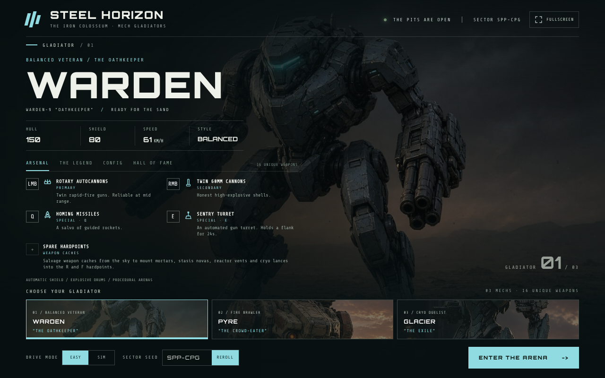

# STEEL HORIZON — The Iron Colosseum

A first-person tank and mech combat simulator that runs entirely in the browser.
Take the gunner's seat of a salvage rig, drop into a procedurally generated
sector, and survive escalating waves of hostile armour. Credits earned in the
sand are spent in **THE FORGE**, where you buy components and bolt them into a
mech that is entirely your own.

Built with **React 19 + TypeScript + Vite + three.js**. Everything you see is
generated at runtime: the terrain, the districts, the roads, the sky, the
mechanics, and every single sound.



---

## Quick start

```bash
cd smech
npm install
npm run dev        # http://localhost:5173
```

Production build (a single self-contained `dist/index.html`):

```bash
npm run build
npm run preview
```

Quality gates:

```bash
npm run typecheck  # tsc --noEmit
npm run lint       # eslint
npm run test       # vitest
npm run check      # all three
```

### Playing the published build

The production build inlines every asset — JavaScript, CSS and three.js — into
one HTML file, so it can be served from any static host. `preview/index.html` in
this repository is that file, regenerated with:

```bash
npm run build
npm run preview:prepare   # copies dist/index.html -> ../preview/index.html
```

It is committed on purpose so the game can be opened straight from a raw file
URL, with no server and no install step:

```
https://raw.githubusercontent.com/shenbigdisk-cmd/sgame/arena/e2b67aef-sgame/preview/index.html
```

---

## Controls

| Input | Action |
| --- | --- |
| `Mouse` | Aim the turret / camera |
| `LMB` / `Space` | Primary weapon (autocannons, scattergun, coil repeater) |
| `RMB` / `C` | Secondary weapon (60mm cannons, flamethrower, cryo grenade) |
| `Q` / `E` | Chassis special hardpoints |
| `W A S D` | Drive (relative to your view in **EASY**, hull-relative in **SIM**) |
| `Z` / `MMB` | Scope |
| `M` | Music on / off |
| `Esc` | Release the mouse (pause menu) |
| `1` `2` `3` | Pick an upgrade after a wave |
| `Enter` / `N` | Call the next wave early |


On touch devices an on-screen stick, fire buttons and module buttons appear
automatically.

---

## The three chassis

| Chassis | Role | Loadout |
| --- | --- | --- |
| **WARDEN-9 "Oathkeeper"** | Balanced veteran | Rotary autocannons · 60mm cannons · Homing missiles · Sentry turret |
| **PYRE-12 "Crowd-Eater"** | Fire brawler | Scrap scattergun · Dragon's Breath · Skyfall slam · Cinder mines |
| **GLACIER-7 "The Exile"** | Cryo duelist | Coil repeater · Cryo grenade · Longbow railgun · Veil smoke |

---

## Systems

### Procedural sectors
Every seed (`ABC-123`) deterministically builds a theme (time of day, weather,
palette), a district layout with named regions, a road network, water bodies,
hills and cover. The perimeter expands every third wave, revealing new
districts and two supply pods in the newly opened ring.

### Waves
Each wave picks a tag — `SWARM`, `ARMORED PUSH`, `SNIPER NEST` or
`FLANKING AMBUSH` — and mixes four enemy chassis (raider tank, hound walker,
goliath heavy, longbow sniper) plus an elite champion. Every fifth wave a
**WARLORD** boss enters the arena. Between waves the arena is repaired, the
shield is refilled and you choose one of three rewards.

### Rewards
Upgrades roll as **STANDARD / RARE / UNIQ** and cover hull, weapon, system and
signature categories. Weapons can be **evolved** into stronger forms
(`STATIC LINK`, `CONCUSSION CORE`, `ABSOLUTE ZERO`, …), and signature upgrades
introduce new mechanics (cluster munitions, reactive armour, overcharged
rounds, repair swarm, killstreak surge, arc discharger, bulwark field,
saturation barrage, supply network).

Every weapon has exactly one evolution, and an evolution only appears once you
own the weapon it upgrades. The four Forge specials evolve too:

| Forge special | Evolution | Effect |
| --- | --- | --- |
| `INCENDIARY MORTARS` | `THERMAL DRUMS` | Pools burn hotter and longer, and never scorch you |
| `STASIS NOVA` | `GLACIAL SHATTER` | Nova deals 20 damage and leaves enemies brittle |
| `OVERDRIVE VENT` | `REACTOR PURGE` | Venting restores shield and purges weapon heat |
| `CRYO LANCE` | `GLACIAL LOCK` | Chilled targets build frost and freeze solid |

### THE FORGE
There is no loot to scavenge. **Credits** are the currency, and they are earned
by fighting: every run pays out on score, waves cleared, kills and personal
bests. Open **THE FORGE** from the hangar and spend them.

Eight slots make up a mech, and every one of them is yours to fill:

| Slot | What it takes | Example |
| --- | --- | --- |
| `FRAME` | The chassis you walk out in — always free | `WARDEN`, `PYRE`, `GLACIER` |
| `PRIMARY` | The trigger weapon | Rotary autocannons, scattergun, coil repeater |
| `SECONDARY` | The heavy weapon | 60mm cannons, cryo grenade, Dragon's Breath |
| `SPECIAL · Q` | One of the Forge specials | Homing missiles, skyfall slam, longbow railgun |
| `SPECIAL · E` | A second special | Sentry turret, cinder mines, veil smoke |
| `ARMOUR` | Hull plating | Lattice armour, ablative carapace |
| `REACTOR` | Shield and power | Fused capacitor, titan reactor |
| `DRIVE` | Legs and speed | Sprint servos, atlas legs |

Components are bought once and kept forever. Mounting one applies its stat
deltas to the frame baseline, so a heavy carapace raises your hull and costs
you top speed — the trade-offs are yours to make. The Forge shows the live
build statistics as you work, and the mech you assemble is the mech you take
into the arena.

### Persistence
Credits, every component you own, the mech name and the exact build you
mounted are written to `localStorage` under `steel-horizon:garage:v1`, so the
Forge is exactly where you left it when you come back. Cockpit settings
(sensitivity, field of view, invert look, render quality, volumes, crosshair,
performance readout) and the hall-of-fame records are stored alongside them.

### Feedback
Procedural audio (weapons, explosions, engines, ambience and an adaptive
score) is synthesised with the Web Audio API and spatialised with stereo pan,
distance muffling and speed-of-sound delay. The HUD tracks hull, shield,
heat, cooldowns, a radar, target telemetry, kill streaks and incoming damage
directions.

---

## Project layout

```
smech/
├─ index.html
├─ vite.config.ts          # single-file production build
├─ vitest.config.ts
├─ eslint.config.js
└─ src/
   ├─ App.tsx               # screen flow: hangar → arena → debrief
   ├─ components/
   │  ├─ Menu.tsx           # hangar: chassis, loadout, legend, config, hall of fame
   │  ├─ Forge.tsx          # THE FORGE: buy components, mount them, name the mech
   │  ├─ GameView.tsx       # canvas host, pause menu, loading screen
   │  ├─ HUD.tsx            # cockpit instruments, radar, crosshair, modules
   │  ├─ UpgradeScreen.tsx  # between-wave reward draft
   │  ├─ GameOver.tsx       # debrief and hall of fame
   │  ├─ SettingsPanel.tsx  # cockpit configuration
   │  ├─ TouchControls.tsx  # on-screen stick + buttons
   │  ├─ Icons.tsx          # inline SVG icon set
   │  └─ FullscreenButton.tsx
   └─ game/
      ├─ engine.ts          # simulation: player, enemies, weapons, effects
      ├─ world.ts           # façade over the world generator
      ├─ layout.ts          # seeded sector layout: theme, districts, terrain
      ├─ mapBuilder.ts      # dresses a layout into a lit, animated arena
      ├─ colliders.ts       # static obstacle grid and collision helpers
      ├─ rng.ts             # the seeded random stream behind every world
      ├─ enemyMeshes.ts     # procedural tank / walker / heavy meshes
      ├─ particles.ts       # instanced billboard particle system
      ├─ readiness.ts       # pure weapon-readiness and aim-assist maths
      ├─ vehicles.ts        # chassis + weapon catalogue
      ├─ forge.ts           # THE FORGE component catalogue and build resolution
      ├─ garage.ts          # credits, owned components, equipped slots, persistence
      ├─ upgrades.ts        # upgrade catalogue and reward rolling
      ├─ weaponEffects.ts   # beam / lightning visuals
      ├─ audio.ts           # procedural Web Audio engine
      ├─ settings.ts        # persisted cockpit preferences
      ├─ records.ts         # hall of fame
      └─ types.ts           # shared types
```

---

## Licence

All code and art in this repository is original to the project.
